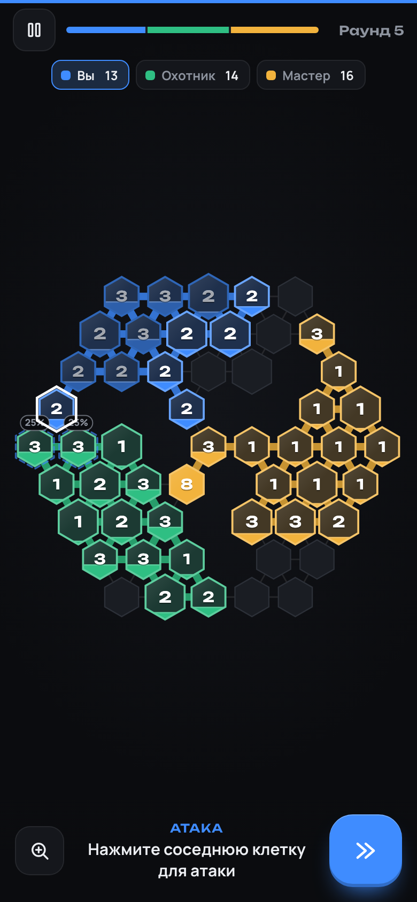
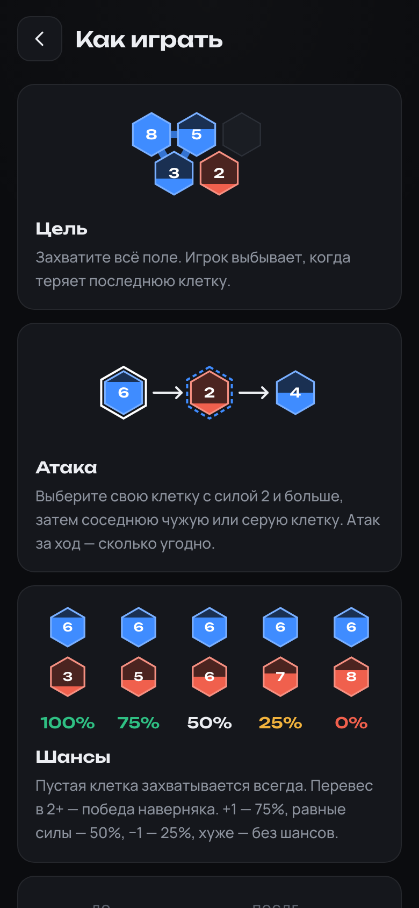

# [▶ Играть в Influence Web](https://nelkio.github.io/influence-web/)

Пошаговая стратегия о захвате территории — прямо в браузере: iPhone, Android, Mac, Windows, Linux.
Фанатский ремейк мобильной игры «Влияние» от Teremok Games.


<p align="center">
  
  &nbsp;
  
  &nbsp;
  
</p>

## Как играть

Поле из шестиугольных клеток. За ход вы атакуете соседей клетками с силой 2+, а затем получаете по единице силы за каждую свою клетку. Чем больше перевес — тем выше шанс победы в бою. Захватите всё поле.

## Что внутри

- **Битвы с ботами** — 5 размеров карт, до 4 соперников, четыре уровня ботов от Психа до Мастера (Мастер просчитывает ходы методом Монте-Карло).
- **Режимы** — тьма, толкотня, союзы, симметрия: честные карты для 2–5 игроков, включая треугольник для троих и звезду для пятерых.
- **Несколько игроков на одном устройстве** — с экраном передачи хода.
- **Дуэли** — онлайн с другом по коду или ссылке (до 5 матчей одновременно), тренировка с ботом, дуэль на одном экране.
- **Карта дня** — одна для всех: в основном необычные сценарии (осада, лабиринт, троянский конь, спящая армия…), каждый четвёртый день — бой с Мастерами. Все 24 сценария можно сыграть и отдельно.
- Статистика, настройки, RU/EN, работает офлайн и ставится на домашний экран как приложение.

## Разработка

```bash
npm install
npm run dev     # локальный сервер
npm test        # unit-тесты и симуляции
npm run e2e     # браузерные тесты (Playwright)
```

TypeScript, Preact, Canvas 2D, Vite. Онлайн-дуэли — WebRTC напрямую между браузерами (PeerJS), без своего сервера.

---

<sub>Код, графика и звуки написаны с нуля. Проект не связан с Teremok Games.</sub>
